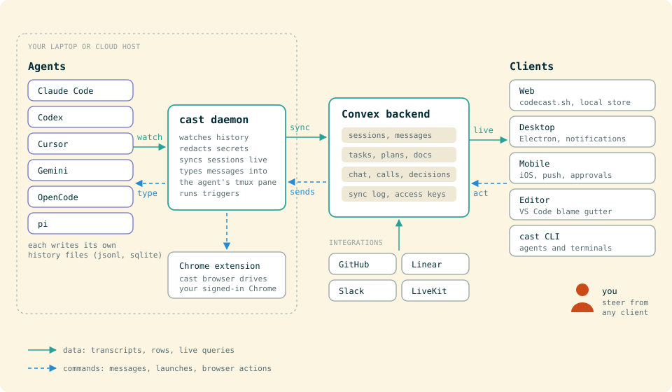

# Codecast docs

Start with the guides. The architecture docs explain how one part of the system works and why, and
name the files that implement it. Proposals and the archive are a record of how the design got
here: each one opens with a dated status line that says what shipped and what replaced it.

## Guides

| Guide | What it covers |
|---|---|
| [Getting started](GETTING-STARTED.md) | Dev environment, env files, running from source, tests, cutting a release |
| [Self-hosting](SELF-HOSTING.md) | Convex, web, CLI, auth, mobile and desktop on your own infrastructure |
| [Contributing](../CONTRIBUTING.md) | Code conventions and repo layout |
| [Orchestration guide](orchestration-guide.md) | Running a plan across agents with `cast plan orchestrate` |
| [Multi-client](multi-client.md) | How each agent client plugs in |
| [exec](exec.md) | `cast exec`: run a prompt on any harness and print the result |
| [Walkie](walkie-run.md) | A five minute script for testing walkie between two people |
| [Anchor runbook](anchor-runbook.md) | Operating the workspace agent |
| [Browser branding](browser-branding.md) | The Cast icon on the separate agent browser on macOS |
| [Releasing mobile](RELEASING-MOBILE.md) | iOS builds, TestFlight, App Store |
| [MDM deployment](mdm.md) | Rolling the app and `cast` out to managed Macs |
| [Prompting](prompting.md) | The standard every shipped prompt follows |
| [Principles](principles.md) | How work is judged on every project's line |

## Architecture

### Sync and the local store

| Doc | |
|---|---|
| [Sync host](architecture/sync-host.md) | One window per origin syncs, the rest replicate over BroadcastChannel |
| [Sync log cargo](architecture/sync-log-cargo.md) | Patches and access stamps carried in the sync log |
| [Sync convergence](architecture/sync-convergence.md) | Server and client run one projection and prove they agree |
| [Sync log migration](architecture/sync-log-migration.md) | The move onto the sync log (shipped) |
| [Sync sim](architecture/sync-sim.md) | Several people and windows simulated in one process |
| [Multiplayer sim harness](architecture/multiplayer-sim-harness.md) | Phase 2 spec for the multiplayer harness |
| [Undo and history](architecture/undo-history.md) | App-wide undo and redo |
| [Durable sync delivery](architecture/sync-outbox.md) | The outbox that supersedes the sync log migration's transaction counter |

### Daemon and agents

| Doc | |
|---|---|
| [Daemon loop](architecture/daemon-loop.md) | The daemon's main process and its read-only workers |
| [Agent definitions](architecture/agent-definitions.md) | Agent definitions and chains |
| [Agent channels](architecture/agent-channels.md) | What a chat line wakes |
| [Session characters](architecture/session-characters.md) | Optional characters for sessions |
| [System resources](architecture/system-resources.md) | Machine load and guided offload |
| [Release signing](architecture/release-signing.md) | Signed CLI release manifests |
| [Claude SDK backend](architecture/claude-sdk-backend.md) | Running a Claude Code session through the Agent SDK |
| [Turn claims](architecture/turn-claims.md) | What happens to a turn when the agent process dies mid-turn |
| [Turn snapshots](architecture/turn-snapshots.md) | A true file history per turn |
| [Agent comms](architecture/agent-comms.md) | What the org tells an agent about whom to talk to |
| [Hosted assistant](architecture/hosted-assistant.md) | The hosted assistant and hosted mode |

### Sessions, teams and machines

| Doc | |
|---|---|
| [Sessions in projects](architecture/session-projects.md) | A project as the workspace for its sessions, tasks, plans and docs |
| [Session multiplayer](architecture/session-multiplayer.md) | Several people typing, sending and steering in one session |
| [Team kit](architecture/team-kit.md) | A team's shared skills, commands, subagents and instructions |
| [Team machines](architecture/team-machines.md) | A Linux box that belongs to a team |
| [Shared hosts](architecture/shared-hosts.md) | One Linux cloud host used by several teammates at once |
| [Vault](architecture/vault.md) | The team's passwords, keys and sign-ins, for people and agents |
| [Vault integration map](architecture/vault-integration-map.md) | Where each piece of the vault build plugs in |
| [Feature guides](architecture/feature-guides.md) | Team feature switches, offers and guides |

### Work, decisions and integrations

| Doc | |
|---|---|
| [Pull requests](architecture/pull-requests.md) | PRs in sync with GitHub, and the owning session that wakes on reviews |
| [Issue sync](architecture/issue-sync.md) | Linear and GitHub issues as tasks, both ways |
| [Decisions as documents](architecture/decisions-as-documents.md) | Decision cards, stacks and routing |
| [Notification delivery](architecture/notification-delivery.md) | One notification per event across windows, desktop and daemon |
| [Live Activity](architecture/live-activity.md) | iOS Lock Screen Live Activity |
| [Slack chat mirror](architecture/slack-chat-mirror.md) | Team chat mirrored to Slack |
| [External data](architecture/external-data.md) | Sources, events, replays, metrics and app connectors |
| [Task graph](architecture/task-graph.md) | Blockers, waits, links and readiness |
| [Ship](architecture/ship.md) | One Ship control for landing a change |
| [Shipping a shared checkout](architecture/ship-checkout.md) | Landing one change from a checkout many agents edit |
| [Deploys](architecture/deploys.md) | Deploys as a stage of the line and an object of their own |

### The line

| Doc | |
|---|---|
| [The line](architecture/the-line.md) | Stations, gates, evidence and runs |
| [The line, end to end](architecture/the-line-end-to-end.md) | From a signal in the world to a shipped, watched change |
| [Line profile](architecture/line-profile.md) | One line per project (`.codecast/line.toml`) |
| [The line model](architecture/the-line-model.md) | The line's objects and where they live |
| [Line map](architecture/line-map.md) | See the whole line, trace one thing, change it in place |
| [Line workspace](architecture/line-workspace.md) | One process, many projects |
| [Flows journeys](architecture/line-journeys.md) | What a person comes to /flows to do, page by page |
| [Flows](architecture/flows.md) | A shared pool of structured ways to run a change |
| [Line versions](architecture/line-versions.md) | What an iteration of the line leaves behind |
| [Learning loop](architecture/learning-loop.md) | How a product learns from what happens to it |
| [Regret](architecture/regret.md) | Which merged changes came back, and which checks let them through |
| [Line principles](line/principles.md) | The principles agents on the line read |

### Org

| Doc | |
|---|---|
| [Org roles](architecture/org-roles.md) | Roles, reporting and the org page |
| [Roles as standing agents](architecture/org-roles-standing.md) | Each role's standing session and what wakes it |
| [Roles that run work](architecture/org-roles-run-work.md) | Roles that run their part of the company |
| [Staffing](architecture/org-staffing.md) | The company model, the head of people, and proposals on the chart |
| [Hiring](architecture/org-hire.md) | Hiring a role from a template |
| [Org templates](architecture/org-templates.md) | Folder org templates |
| [Org init](architecture/org-init.md) | Org init and update (partly superseded by staffing) |
| [Scopes and feed](architecture/scopes-and-feed.md) | Role scopes and the scope page |
| [Initiatives and projects](architecture/initiatives-projects-role-page.md) | Initiatives, projects, and the role page |
| [Org eval](architecture/org-eval.md) | Evaluating the org system end to end |
| [Head of people prompt](architecture/head-of-people-prompt.md) | The head of people's standing prompt |
| [Union ops role](architecture/union-ops-role.md) | The ops role for Union |

### Evals

| Doc | |
|---|---|
| [Evals](architecture/evals.md) | Replaying prod prompts against frozen moments |
| [Evals home](architecture/evals-home.md) | One eval home on `@platform/evals` |
| [Evals UI](architecture/evals-ui.md) | The evals UI |
| [Evals converge](architecture/evals-converge.md) | Spec for converging evals on `@platform/evals` |

## Proposals

Each opens with its status. Shipped proposals stay as the record of why the design took its shape.

| Proposal | Status |
|---|---|
| [Changes page](proposals/changes-page.md) | Shipped; week edition only from phase 2 |
| [Codex Cloud support](proposals/codex-cloud-support.md), [spike](proposals/codex-cloud-spike-findings.md), [report](proposals/codex-cloud-implementation-report.md) | Shipped; VM environments open |
| [Org](proposals/org/index.html) | Shipped |
| [One line](proposals/one-line/index.html) | Shipped; contract is `architecture/the-line.md` |
| [The line end to end](proposals/the-line-end-to-end/index.html) | Partly shipped |
| [Agent roles](proposals/agent-roles/index.html) | Superseded by the org proposal |
| [Agent organization](proposals/agent-organization/README.md) (v1 and v2) | Superseded by the org proposal |
| [Codecast for everyone](proposals/codecast-for-everyone.md) | Not built |

## Research notes

| Note | |
|---|---|
| [Fabro analysis](fabro-analysis.md) | Ideas taken from Fabro; most were adopted |
| [Aivery on codecast](aivery-on-codecast.md) | Mostly built in another shape (org roles) |
| [HumanLayer analysis](humanlayer-analysis.md) | HumanLayer compared with codecast; the adopted items are built |

## Archive

Superseded plans, specs and roadmaps, kept for the reasoning behind them. Every file opens with
what shipped and what replaced it. See [archive/](archive/).

## Writing docs

- Check every command, path and flag against the tree before writing it down.
- Diagrams are hand-written SVG in [diagrams/](diagrams/), following [diagrams/STYLE.md](diagrams/STYLE.md).
- Screenshots come from the homepage's product film, which renders the real views over fixture
  data, so nothing private reaches a public image. See [screenshots/CAPTURE.md](screenshots/CAPTURE.md).
