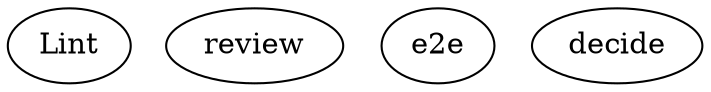

# The pipeline: every change's path from edit to live

A project's pipeline is the path every change in it takes to production: the
flow each change runs through, main, and the flow each release runs through.
Codecast already has every piece: flows and segments (flows.md), backbones and
slots (FL8), deploy targets and deploys (deploys.md), the Ship press
(ship.md). This document makes them one object a person can read at a glance,
watch live, and change in a sentence. Sections are PL0 onward so code can
cite them.

## PL0. Why

Before this, a person asking "what happens to my change?" had to read four
places: the flow library on /flows (a list of flows, none marked as the one
this project's changes take), the run card, /deploys, and GitHub Actions for
whatever a deploy workflow runs. Release had no shape in codecast at all.
Changing the path meant editing DOT: adding one check after Check meant
re-writing every edge out of Check, its failure route included. So nobody did,
and repos copied whole graphs instead of saying how they differ.

## PL1. Words

| Word | Meaning |
|---|---|
| pipeline | a project's change flow, main, and release flow, read as one |
| change flow | the flow a session's change runs when it presses Ship: the team's default flow as this repo resolves it (`.codecast/flows/change.cast` before the shipped `change`) |
| release flow | the flow a release runs: main's commits since what is live, as one batch, out to every target they touch |
| station | one step: what it does, who does it (agent, command, person, rule, eval, deploy), and when it runs |
| backbone | the library flow a project's flow extends; its stations are inherited |
| own station | a station this project added or changed; everything else is inherited and keeps receiving the team's improvements |
| edit | one typed change to a project's flow: add a station, add guidance to a prompt, replace a prompt or command, skip a station, set when one runs |

## PL2. Scope: per change and per release

Every station runs either once per change, on that change's own tree, or once
per release, on the batch. The rule a project follows when placing one: **a
change pays for what it can break; a release pays for everything else once.**
A typecheck of the programs a change touched is per change; the full suite,
the eval gate and the deploy are per release. The pipeline draws the change
flow above main and the release flow below it, so the scope of a station is
where it sits.

## PL3. Edits are small, typed and inherited

A project's flow names its backbone (`extends="change"`) and says only how it
differs. Five edits cover what people do:



- `after="<station>"` (or `before=`) puts a new station on the passing path
  next to an existing one. It takes the passing route out of that station, and
  on failure it uses the same way back that station uses, so a new check fails
  the way Check fails without a word about edges.
- `guide=` appends text to the inherited prompt, so the project's house rules
  sit on top of the team's prompt and improvements to the team's prompt still
  arrive. `prompt=` still replaces it, for when a project needs its own.
- `when=` runs a station only when the change (or the release's batch)
  touches those paths; otherwise it passes, recorded as skipped.
- `skip=true` takes a station off the path and joins its neighbours.

Each is one line in one file, reads as what it does, and diffs as what it
does. `cast flow edit` writes them (PL5); a person never has to.

## PL4. Release is a flow

The shipped `release` backbone runs on a batch: `cast flow run release` binds
`$from` (the sha live on the targets) and `$to` (main's head) and the changes
between them. Its stations: Cut, then the project's release checks (a slot),
then Go (a person's press or the project's policy), Deploy (each deploy target
the batch touches, from deploy.toml), Verify, and Watch. A project fills the
slots with its own steps. A release run is the deploy's record (dp-N) and the
deploy page's history reads it.

## PL5. Editing from anywhere

The same five edits, three ways in, one path out:

- **A sentence in a conversation.** An agent runs `cast flow edit <flow> add
  lint --after check --run "bun run lint"` (or `guide`, `prompt`, `skip`,
  `when`). It writes the project's flow file, validates the result, and prints
  an edit object that draws inline: the pipeline with the new or changed
  station marked, the file diff folded under it, and what it costs (how many
  of the last 50 changes it would have run on).
- **The pipeline page.** `+` between two stations, or Edit in a station's
  panel, opens the same edit as a form, previews the same object, and hands
  it to a session that makes it.
- **The CLI**, by hand.

An edit is a change like any other: it ships through the pipeline it edits.

## PL6. What people see

- **/pipeline** (per repository): the change lane, main, the release lane,
  each station marked inherited or own, with when it runs and who does it; the
  changes in flight on each station; what sits on main waiting; the release
  going out. A station opens its panel: what it runs, its prompt (inherited
  text and the project's guidance shown apart), its recent runs, and Edit.
- **In a conversation**, ` ```flow {"pipeline":"<repo>"} ``` ` draws the
  pipeline compact and live, and an edit draws as PL5 says.
