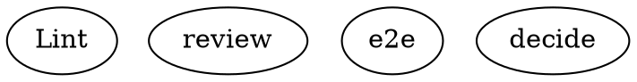

# The pipeline: every change's path from edit to live

A project's pipeline is the path every change in it takes to production: the
flow each change runs through, main, and the flow each release runs through.
Codecast already has every piece: flows and segments (flows.md), backbones and
slots (FL8), deploy targets and deploys (deploys.md), the Ship press
(ship.md). This document makes them one object a person can read at a glance,
watch live, and change in a sentence. Sections are PL0 onward so code can
cite them.

## PL0. Why

Before this, a person asking "what happens to my change?" had to read four
places: the flow library on /flows (a list of flows, none marked as the one
this project's changes take), the run card, /deploys, and GitHub Actions for
whatever a deploy workflow runs. Release had no shape in codecast at all.
Changing the path meant editing DOT: adding one check after Check meant
re-writing every edge out of Check, its failure route included. So nobody did,
and repos copied whole graphs instead of saying how they differ.

## PL1. Words

| Word | Meaning |
|---|---|
| pipeline | a project's change flow, main, and release flow, read as one |
| change flow | the flow a session's change runs when it presses Ship: the team's default flow as this repo resolves it (a repo flow named change, in the repo's own flows directory, before the shipped `change`) |
| release flow | the flow a release runs: main's commits since what is live, as one batch, out to every target they touch |
| station | one step: what it does, who does it (agent, command, person, rule, eval, deploy), and when it runs |
| backbone | the library flow a project's flow extends; its stations are inherited |
| own station | a station this project added or changed; everything else is inherited and keeps receiving the team's improvements |
| edit | one typed change to a project's flow: add a station, add guidance to a prompt, replace a prompt or command, skip a station, set when one runs |

## PL2. Scope: per change and per release

Every station runs either once per change, on that change's own tree, or once
per release, on the batch. The rule a project follows when placing one: **a
change pays for what it can break; a release pays for everything else once.**
A typecheck of the programs a change touched is per change; the full suite,
the eval gate and the deploy are per release. The pipeline draws the change
flow above main and the release flow below it, so the scope of a station is
where it sits.

## PL3. Edits are small, typed and inherited

A project's flow names its backbone (`extends="change"`) and says only how it
differs. Five edits cover what people do:



- `after="<station>"` (or `before=`) puts a new station on the passing path
  next to an existing one. It takes the passing route out of that station, and
  on failure it uses the same way back that station uses, so a new check fails
  the way Check fails without a word about edges. Where that station has no
  way back, the backbone's `graph [fix="<station>"]` names one (a change flow
  sends a failed added check to Brief, which tells the session); `fix=` on the
  new station overrides both.
- `guide=` appends text to the inherited prompt, so the project's house rules
  sit on top of the team's prompt and improvements to the team's prompt still
  arrive. `prompt=` still replaces it, for when a project needs its own.
- `when=` runs a station only when the change touches those paths;
  otherwise the change goes past it. A run that does not know its files runs
  the station rather than skip it unseen. The release lane takes `when=` once
  a release run carries its batch's files; until then it is refused there.
- `skip=true` takes a station off the path and joins its neighbours.

Each is one line in one file, reads as what it does, and diffs as what it
does. `cast flow edit` writes them (PL5); a person never has to.

An edit is checked against what the runner does, not only against the graph:
stations inside a fan-out (the branches that run side by side, and the join
that waits for them) take no `after`, `before`, `skip` or `when`, since the
runner runs exactly the branches the fan-out names; place the station before
the fan-out or after its join. A station whose anchor has no way back names
its own (`fix=`) or says that a failure ends the run. A flow using these edits
needs a CLI that reads them: the release that ships them raises the CLI floor,
so no older machine runs a different graph from the one the page draws.

## PL4. Release is a flow

A release already is one: every deploy a codecast press sends (dp-N) runs
`line-deploy.cast` (deploys.md DP8), CI, Send, Gate, Roll out, Live, Watch,
each step a command of the target it sends (`targetDeployProfile`, DP13; the
profile's `[line.deploy]` only for a line deploy with no target action). Where
targets run a step differently the lane says so, and a station's panel lists
each target's command. The pipeline draws
that flow as the release lane, as the repo resolves it, so a project edits it
the way it edits its change flow (PL3). A step with no command says so ("no
command: passes") rather than passing silently, and a deploy sent outside
codecast (a GitHub workflow run, `cast ship mark`) says its steps were not
followed here rather than drawing them as passed.

What runs a release (a person's press, a role's grant, a train on green main)
stays the deploy path's (DP4); the pipeline shows it and does not add a
second driver. Union's train (pl-1075) and its culprit routing land as
stations of this lane when they exist.

## PL5. Editing from anywhere

The same five edits, three ways in, one path out:

- **A sentence in a conversation.** An agent runs `cast flow edit <flow> add
  lint --after check --run "bun run lint"` (or `guide`, `prompt`, `skip`,
  `when`). It writes the project's flow file, validates the result, and prints
  an edit object that draws inline: the pipeline with the new or changed
  station marked, the file diff folded under it, and what it costs (how many
  of the last 50 changes it would have run on).
- **The pipeline page.** `+` between two stations, or Edit in a station's
  panel, opens the same edit as a form, previews the same object, and hands
  it to a session that makes it.
- **The CLI**, by hand.

An edit is a change like any other: it ships through the pipeline it edits.
An edit made from a project's pipeline writes that project's flow file, never
the team's backbone; changing the backbone for every project is its own,
explicit act. The page never writes a checkout directly: a press starts a
session with the exact command, the session makes the edit, and its change
lands on main reviewed, so the pipeline is never edited by an uncommitted
write on one machine.

## PL6. What people see

- **/pipeline** (per repository): the change lane, main, the release lane,
  each station marked inherited or own, with when it runs and who does it; the
  changes in flight on each station; what sits on main waiting; the release
  going out. A station opens its panel: what it runs, its prompt (inherited
  text and the project's guidance shown apart), its recent runs, and Edit.
- **In a conversation**, ` ```flow {"pipeline":"<repo>"} ``` ` draws the
  pipeline compact and live, and an edit draws as PL5 says.

## PL7. One drawing, one vocabulary

The pipeline, the library, the fence and a run card all draw through
`FlowDiagram` over one pure model (`lib/line/flowDiagram.ts`, shared with the
phone); a pipeline is that model over two flows joined by main, with a badge
row per station (who, own or inherited, when, what is on it now). Words, on
every surface: a **station** is a step; a **target** is a place code goes
live; a station is named by its flow's label (deploy steps by
`LINE_DEPLOY_STEP_LABELS`); no id or hash is shown where a name exists.

## PL8. Every machine's checkouts

Work main does not have lives on machines: a shared checkout with sessions
mid-edit, a worktree a session finished in, a laptop that stopped levelling.
The pipeline shows it under the release lane, per repository: each machine's
checkouts with the commits main lacks, how far behind main each is, its
uncommitted work grouped by the session that wrote it (attribution as `cast
ship checkout` reads it, plus the files a `cast` command wrote for a session,
`land/writeLedger.ts`), and its level state in words. A finished session's work
offers Ship, which asks that session to run its change through the flow.

A daemon reports its checkouts on change only, within a time budget per pass,
and never on the path of its own event loop; a checkout whose attribution is
not warm yet reports its paths unattributed. A level that keeps refusing on
the same files asks for help once per episode: the session that last wrote one
of those files hears the conflict and the two ways out (rebase the edit onto
main's version, or set it aside), else a finding is filed on the repository's
project. A refusal is logged when it changes, not every pass.

## PL9. What dogfooding taught the design

The first real edit made from the page (Union's Review guidance, Nov 21) ran
end to end and found what the tests had not:

- **An edit is the session's change.** Files a `cast` command writes for a
  session are attributed to it (`writeLedger`), so `cast flow run` after `cast
  flow edit` ships them without a workaround.
- **A release ships the commit it names.** A deploy request pins its sha, and a
  target whose command sends the tree it runs in refuses any sha but main's
  head instead of shipping something else.
- **A repository is known by its remote**, not by the name of a folder, so a
  clone under another name still finds its pipeline, runs and proposed edits.
- **Silent stalls are product bugs.** A checkout stuck for 21 hours and a
  release request open for two days were both visible only in logs; each now
  has a place on the page and a person or session it reaches.
